# Aspect-Oriented-Programming
## Premier Aspect
#### Code Advice before et after
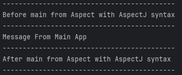
#### Syntax syntax AspectJ et syntax Class
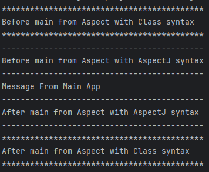

## Application Banque
#### test d'application
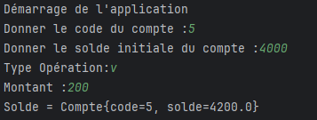

### Aspect de Logging
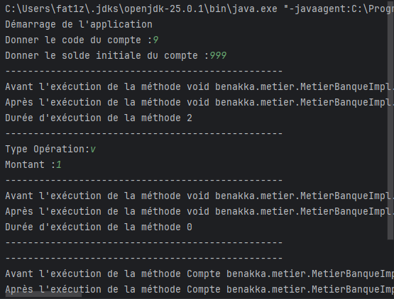
#### avec logger.info
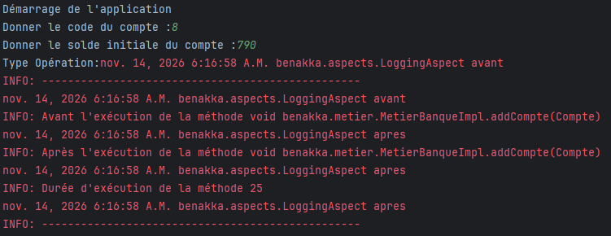
#### logging dans un fichier xml
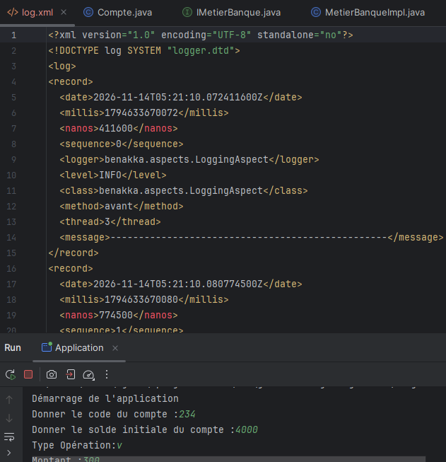

### Aspect Patch
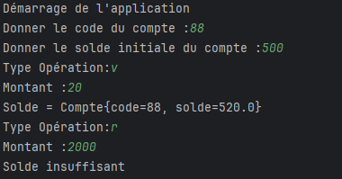

### Aspect Securité
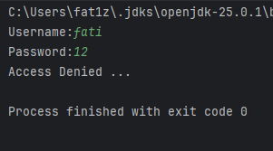
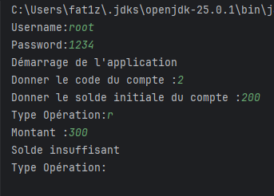

## Spring AOP
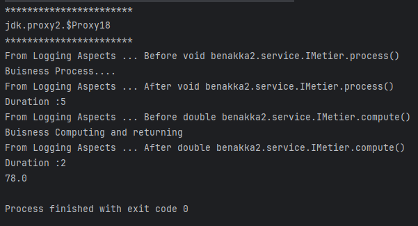
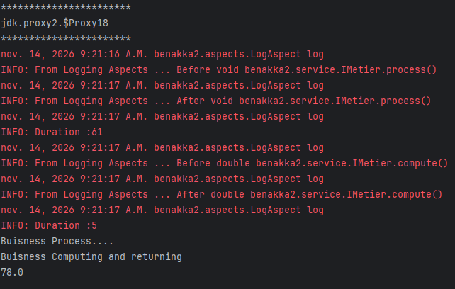